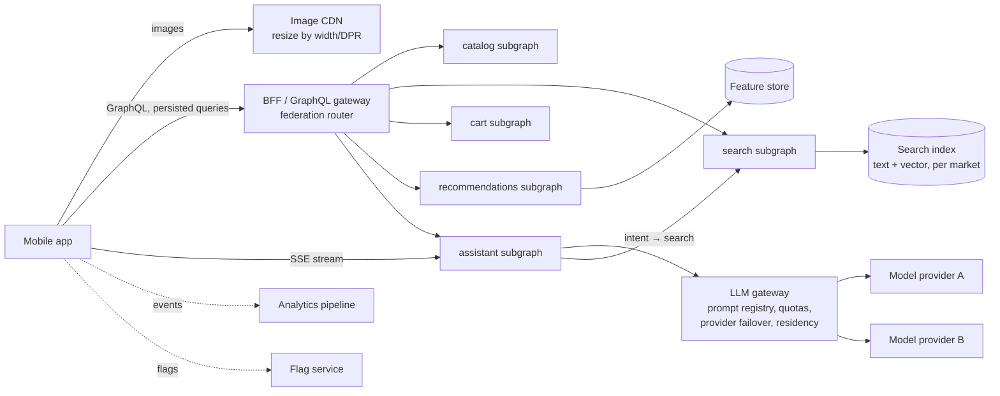

# System design: AI shopping assistant and search

> **Prompt:** "Design the AI shopping assistant / search for a mobile app with millions of users in many markets."
>
> Interview notes for a 45–60 minute whiteboard session. **First draft (end of Phase 1).** Every number is an **assumption**, not a measurement. The last section says what this repo builds and what exists only on paper; task 4.13 revises this document against the real code.

## 1. Clarifying questions and requirements

Ask first (2–3 minutes): which markets and languages? Is the assistant for discovery only, or can it change the cart? Is there an existing search backend? What share of devices can run an on-device model? Is there a privacy rule about sending user text to a cloud model in some markets?

**Functional**

- Search: typeahead, results with filters (diet, cook time, price, allergens) and sort, pagination, empty and error states, deep-linkable searches.
- Assistant: natural-language request ("vegetarian dinner for 4 under 30 min, no nuts") → streamed answer + **real** catalog cards → add to cart from the chat.
- Cart that works offline. Home feed and a "For you" shelf.

**Non-functional**

| Concern | Target (assumption) |
|---|---|
| Typeahead | server p95 < 150 ms; result visible < 400 ms after the last keystroke (250 ms debounce included) |
| Search results | p95 < 800 ms from submit to first rows on 4G |
| Assistant | first token p95 < 1.5 s (cloud), < 0.5 s (on-device); cards < 4 s |
| Offline | app opens with cached feed; cart edits queue and sync; assistant degrades to keyword search |
| Markets | per-market catalog, currency, units, language, allergen labelling rules, data residency |
| Accessibility | screen reader labels, dynamic type, 44 pt targets, streamed text announced in sentences, not tokens |
| Safety | allergen filters always applied in code; model never invents products |

## 2. Back-of-envelope numbers

All rows are **assumptions** chosen to make the arithmetic easy.

| Quantity | Assumption | Result |
|---|---|---|
| Daily active users | 5 M | — |
| Searches | 1.5 sessions × 4 searches per user per day | 30 M/day ≈ **350 rps avg, ~1,200 rps peak** (peak ≈ 3.5× avg, around dinner time per time zone) |
| Typeahead calls | 3 per search after debounce | 90 M/day ≈ 1,000 rps avg, ~3,500 rps peak |
| Assistant users | 10 % of DAU × 3 messages | 1.5 M requests/day ≈ 17 rps avg, ~60 rps peak |
| Cloud share | 70 % (rest on-device or keyword) | ~1 M cloud LLM calls/day |
| Tokens per call | ~800 in (system prompt + last 6 messages), ~150 out | ~1 B tokens/day. Cost = 1,000 × P per day for a blended price of P per million tokens. A 20 % intent-cache hit rate saves a fifth |
| Search page payload | 20 items × ~300 B JSON | ~6 KB raw, ~2 KB gzipped |
| Images per page | 20 thumbnails × ~25 KB (WebP, sized for the device) | ~500 KB: **images dominate the bytes**, not GraphQL |
| Assistant stream | ~150 tokens + framing | ~2 KB per answer |
| Persisted client cache | cap | 5 MB in MMKV, purged when larger |

Takeaways: search QPS is high but cheap and cacheable; LLM QPS is low but expensive and slow, so the design optimizes **cost and latency per assistant call**, and **image delivery** for search.

## 3. High-level diagram

The assistant subgraph turns text into an intent and calls the **same** search subgraph the search screen uses. The LLM gateway is the only place that holds model keys, prompts and per-market routing.

## 4. Client architecture

- **Modules.** Feature folders (`search`, `assistant`, `cart`, `catalog`, `recommendations`) with `model/` (pure logic), `api/`, `hooks/`, `components/`. Features talk to each other only through an `index.ts`. Shared layers: design system, `lib` (Apollo, storage, i18n), analytics, flags, AI.
- **Navigation.** File-based routes: four tabs, detail stacks, the assistant as a modal. Deep links (`pantry://recipe/:id`, `pantry://search?q=pasta&diet=vegan`) also work from a cold start. Search filters live **in the URL**, so a search is shareable and restorable.
- **State.** One owner per value: server data in the normalized Apollo cache; settings, session and the offline queue in Zustand; deep-linkable state in route params; the conversation in a reducer ([ADR 0005](adr/0005-server-state-apollo-client-state-zustand.md)).
- **Caching.** Normalized cache, so a product updated in the cart is updated in search, chat cards and details at once. Type policies merge cursor pages. The cache is persisted to MMKV with a size cap and a schema-version key that drops an old cache after an app update. Feed uses `cache-and-network`.
- **Offline.** Cached feed and details render with an offline banner. Cart edits become **operations** with idempotency keys in a persisted queue; the screen shows server cart + queued operations; replay with backoff on reconnect. The assistant falls back to the on-device model or to rule-based parsing.
- **Images.** CDN URLs with width and DPR parameters, WebP/AVIF, blurhash placeholders, memory + disk cache (`expo-image`), prefetch of the next page's thumbnails, recycled list rows (FlashList).

## 5. API design

- **Queries.** `search(input, first, after)` with a typed `SearchInput` (query, filters, sort); `suggestions(prefix)`; `feed`; cart mutations that **return the whole cart** and take an `idempotencyKey`. Production adds persisted queries (smaller requests, a known set of operations per app version) and query cost limits.
- **Pagination.** Opaque cursors, not offsets: stable when items are inserted, and the server can change the cursor format freely.
- **Streaming the assistant.**

  | Option | For | Against |
  |---|---|---|
  | **SSE** over HTTP | one-way server→client fits token streams; plain HTTP through CDNs and proxies; easy retry and cancel (`AbortController`) | needs a streaming `fetch` on React Native; one stream per request |
  | WebSocket | two-way; good for live features | connection state to manage on flaky mobile networks; harder to load-balance; overkill for request/response |
  | GraphQL `@defer` | one API surface; intent and cards could arrive as deferred fragments | streams fragments, not tokens; client and gateway support is uneven |

  Lean: **SSE** for tokens, a final structured `intent` event, then a normal GraphQL `search`. The repo decides after the Phase 4 spike (task 4.1, in its own ADR).
- **Old app versions in the stores.** Schema changes are additive only; mark fields `@deprecated` and remove them only when usage from **supported** versions is zero (the gateway logs field usage per client name and version). Clients treat unknown enum values and union members as "unknown", not as a crash. A minimum supported version comes from remote config (see section 7).

## 6. AI specifics

| | On-device | Cloud |
|---|---|---|
| Privacy | text never leaves the device | needs consent and residency rules per market |
| Cost | free per call | per token, grows with traffic |
| Latency | no network; fast first token on new hardware | network + queueing; better on slow devices |
| Model size and quality | small model: good for intent extraction, weak at open conversation | large model, better reasoning and languages |
| Device coverage | recent iPhones with Apple Intelligence; Android fragmented; download size if the model is shipped separately | every device online |
| Updates | tied to OS or a model download | change any time on the server |

- **Use the model for intent, not for products.** It returns `{ query, filters, servings, maxTime }`, validated with Zod. Invalid → one repair retry → next provider → keyword fallback. Allergens from the message and from settings are merged into the filters **in code** ([ADR 0006](adr/0006-ai-provider-abstraction.md)).
- **Non-determinism.** Low temperature, schema-constrained output, the intent cache for identical queries, and a UI that never depends on exact wording.
- **Evaluation.** A golden set of queries per language and market with expected intents, run in CI on every prompt or model change; online metrics: zero-result rate after an intent, add-to-cart from chat, invalid-output rate, refusal rate; a small human-reviewed sample.
- **Prompt versioning.** Prompts live in the LLM gateway's registry with an id; every `ai_request` event carries prompt id, model and provider; new prompts roll out behind a flag like any other change.
- **Kill switch.** Flags per market: assistant off, force keyword mode, disable cloud, plus timeouts, history length and max tokens as flag values. No release needed.

## 7. Rollout

- **Flags per market** with targeting (market, app version, platform); every exposure logged once per session.
- **A/B tests:** assignment by hash of user id + flag key; primary metric (add-to-cart rate from search or chat) plus guardrails (crash-free rate, search p95, AI cost per session).
- **Staged store rollout:** Apple phased release (7 days), Google Play staged percentages; halt on crash or metric regressions.
- **OTA updates (EAS Update):** JS and assets only, matched by runtime version. **Cannot** change native code, add a native module or a permission, or change the app icon; must stay within store review rules. Good for hotfixes and prompt-adjacent UI changes.
- **Forced update:** remote config holds `minSupportedVersion` and `recommendedVersion` per platform; below minimum → blocking screen with a store link; below recommended → dismissible prompt. The gateway can also reject an operation from an unsupported version with a typed error.

## 8. Observability

| Signal | Example target (assumption) |
|---|---|
| Crash-free sessions | ≥ 99.8 % per release |
| Cold start, TTI | p50 / p95 per device class; alert on +15 % vs previous release |
| Search latency | p95 submit → first row rendered, measured on the client |
| AI | first-token and intent latency per provider; **fallback rate** by provider, market and app version; invalid-output rate; tokens and cost per day |
| Cart sync | queue length at reconnect, rejected operations |

Dashboards are sliced by release, market and platform. Alerts fire on threshold and on regression against the previous release. Errors and traces go to Sentry (release health); product events go through the typed analytics layer.

## 9. Risks and trade-offs

| Risk | Mitigation | Trade-off |
|---|---|---|
| LLM slow or down | per-provider first-chunk timeout, fallback chain ending in keyword search, visible degradation chip | weaker answers during an incident |
| Model invents products | model returns intent only; cards come from search | one extra round trip |
| Allergen mistake | exclusions enforced in code from settings and message | cannot rely on the model's nuance |
| Cost runaway | max tokens, short history, intent cache, per-user quota, kill switch | shorter context can hurt quality |
| Prompt injection | narrow system prompt, no tools with side effects, output is a typed intent | less flexible assistant |
| Old app versions | additive schema, field-usage tracking, forced update | schema carries deprecated fields for months |
| On-device coverage | capability check per device, cloud as default | two code paths to test |
| Offline cart conflicts (price or stock changed) | server is the source of truth; replay shows changes to the user | the cart can change after sync |
| Data residency | LLM gateway routes per market; on-device where required | fewer model choices in some markets |

## 10. How this repo maps to the design

> **Pending (first draft).** Task 4.13 completes this table against the code. Status today: ✅ **Built** (in the repo, tested) · 🟡 **Planned** (a task in [PLAN.md](PLAN.md); not built yet) · 📝 **Paper only** (exists only in this document).

| Design element | Status | Where |
|---|---|---|
| Feature-folder modules, folder rules | ✅ Built | [apps/mobile/src/features/](../apps/mobile/src/features/), [CLAUDE.md](../CLAUDE.md) |
| Navigation: tabs, stacks, modal, typed routes, deep links from cold start | ✅ Built | [app/\_layout.tsx](../apps/mobile/app/_layout.tsx), [deepLinks.test.tsx](../apps/mobile/src/__tests__/deepLinks.test.tsx) |
| Design system, light/dark themes, safe areas | ✅ Built | [src/design-system/](../apps/mobile/src/design-system/) |
| i18n (EN, PL) with typed keys | ✅ Built: 2 languages. Many markets, currencies, RTL: 📝 | [src/lib/i18n/](../apps/mobile/src/lib/i18n/) |
| Settings incl. AI mode | ✅ Built, in memory only. MMKV persistence: 🟡 2.2 | [features/settings/](../apps/mobile/src/features/settings/) |
| GraphQL contract and generated types | ✅ Built | [schema.graphql](../packages/shared/schema.graphql) |
| Cursor pagination, idempotent cart mutations | ✅ Built in the mock server | [server/src/pagination.ts](../server/src/pagination.ts), [server/src/cart.ts](../server/src/cart.ts) |
| Latency and error injection | ✅ Built (`DELAY_*`, `ERROR_RATE`) | [server/src/config.ts](../server/src/config.ts) |
| CI (typecheck, lint, test, codegen check, Expo Doctor) | ✅ Built | [.github/workflows/ci.yml](../.github/workflows/ci.yml) |
| Normalized cache, type policies, data masking | ✅ Built ([ADR 0007](adr/0007-apollo-cache-pagination-masking-persistence.md)). MMKV persistence: 🟡 2.2–2.3 | [src/lib/apollo/](../apps/mobile/src/lib/apollo/) |
| Image strategy | 🟡 `expo-image` in 2.5. CDN resizing: 📝 | — |
| Search UI (typeahead, filters in URL, states) | 🟡 3.1–3.5 | — |
| Search index | 📝 Mock uses in-memory token matching, English-only tokenizer | [server/src/search.ts](../server/src/search.ts) |
| Offline cart queue | 🟡 3.9–3.10 | — |
| Analytics events, flags, A/B (`search_layout`) | 🟡 3.6–3.8. Remote flag service, analytics pipeline: 📝 (GrowthBook adapter: stretch 7.3) | — |
| AI router, providers, Zod intent, keyword fallback, guardrails | 🟡 4.2–4.11, designed in [ADR 0006](adr/0006-ai-provider-abstraction.md) | — |
| Streaming transport | 🟡 4.1 spike → its own ADR | — |
| LLM proxy (mock + one real provider) | 🟡 4.5. Full LLM gateway (registry, quotas, failover, residency): 📝 | — |
| On-device provider | 🟡 Phase 6, Simulator only | — |
| Federation | 🟡 Stretch 7.1–7.2 (catalog and cart subgraphs). Search, recommendations, assistant subgraphs: 📝 | — |
| Recommendations | Stub resolver today; heuristic shelf 🟡 7.5; ML: 📝 | [server/src/resolvers.ts](../server/src/resolvers.ts) |
| Sentry, performance numbers | 🟡 5.5–5.7. Dashboards and alerts: 📝 | — |
| EAS, OTA, staged rollout, forced update | 🟡 5.8 as config and a document. Forced-update mechanism: 📝 | — |
| AI evaluation set, prompt registry | 📝 Router tests with fake providers: 🟡 4.3 | — |
| Auth, payments, real multi-market catalog | 📝 Out of scope ([SPEC](../SPEC.md) section 1) | — |
